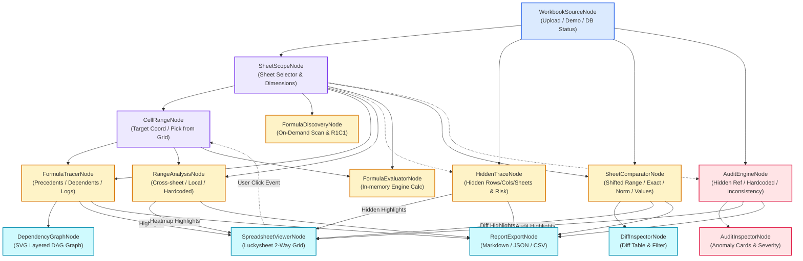

# Rencana Implementasi: Visual Node-Based Workflow Frontend
## Web Excel Formula Intelligence (Audit Lengkap Source Code Eksisting)

---

## 1. Ringkasan Hasil Pemeriksaan Source Code Eksisting

Setelah melakukan audit menyeluruh terhadap **seluruh baris kode di `backend/` dan `frontend/`**, ditemukan sejumlah fitur penting yang telah diimplementasikan di kode namun **belum/tidak tercatat di file markdown (PRD/README)**. 

Semua fitur kode ini dimasukkan ke dalam arsitektur node visual agar **100% lengkap tanpa ada satu pun yang tertinggal**:

### 🔍 Fitur-Fitur Kode yang Ditemukan Langsung dari Kodingan:
1. **Hidden Dependency Tracer & Risk Consumers (`hidden_tracer.py` & `HiddenTracePanel.jsx`):**
   - Mendeteksi baris tersembunyi (`hidden_rows`), kolom tersembunyi (`hidden_cols`), dan sheet tersembunyi (`hidden` serta `veryHidden`).
   - **Critical Visible Consumers:** Menghitung dan melacak sel tersembunyi yang dipakai secara aktif oleh sel formula yang terlihat di layar (*Risiko Tinggi*).
   - Filter `only_in_use`, filter per-sheet vs all sheets, search bar multi-kriteria, serta kemampuan *Trace Dependent* langsung dari elemen tersembunyi.
2. **Range Dependency Inspector & Heatmap (`formula_tracer.py:analyze_range` & `RangeAnalysisPanel.jsx`):**
   - Menganalisis range sel arbitrer (misal `B2:D10`).
   - Mengelompokkan setiap sel ke dalam 4 kategori presisi:
     - 🔵 **Cross-Sheet Precedents** (mengambil data dari sheet lain).
     - 🟣 **Local Formulas** (formula dalam sheet yang sama).
     - 🟡 **Hardcoded Numbers** (angka statis yang disisipkan tanpa formula).
     - ⚪ **Empty Cells**.
   - Heatmap highlights di Luckysheet: Sky Blue (`#7dd3fc`), Soft Indigo (`#c7d2fe`), Soft Amber (`#fde68a`).
3. **Execution Engine Logs & Live Performance Timer (`formula_tracer.py` & `TracePanel.jsx`):**
   - `execution_logs`: Log langkah demi langkah tracing dengan timestamp `[HH:MM:SS]`, kategori event (`[Target]`, `[Level N]`, `[Memproses Sel]`, `[Akar Input]`, `[SELESAI]`).
   - Live performance timer (`elapsed_seconds`), depth reached counter, copy-to-clipboard logs.
4. **Formula Evaluation Engine (`formula_evaluator.py`):**
   - Evaluator formula in-memory dengan resolusi dependensi bertahap (hingga 25 pass iterasi).
   - Mendukung parsing fungsi agregasi `SUM`, `AVERAGE`, `MIN`, `MAX`, operator aritmatika, serta substitusi referensi sel lintas-sheet.
5. **Audit Anomali Referensi Data Tersembunyi (`formula_auditor.py:74-101`):**
   - Anomali tipe `hidden_reference`: Mendeteksi formula yang merujuk pada sel di dalam baris/kolom/sheet yang tersembunyi.
   - Anomali `hardcoded_in_series`, `formula_inconsistency` (Normalized pattern outlier), `external_reference` (`[Book.xlsx]`), dan `ref_error` (`#REF!`, `#VALUE!`, `#DIV/0!`).
6. **Perbandingan Range Geser/Offset & Sinkronisasi Range (`formula_comparator.py` & `CompareView.jsx`):**
   - Mendukung perbandingan range bergeser (*shifted ranges*, misal `B4:F8` vs `C4:G8` dengan visual `coord_b ↔ coord_t`).
   - Opsi `syncTargetWithBaseline` untuk mengunci range target mengikuti baseline.
   - Tombol `useSelection` untuk mengisi range dari seleksi aktif spreadsheet.
   - 3 Mode: `exact_formula`, `normalized_formula`, `values_only` + 2 Alignment: `coordinate` dan `structural`.
7. **PostgreSQL Schema Persistence & Migration CLI (`db_service.py`, `migrate.py`, `routes_workbook.py`):**
   - Pelacakan status migrasi skema non-public (`formula_intelligence.uploaded_workbooks`).
   - Endpoint status DB `/api/workbook/database-status` & endpoint hapus workbook `DELETE /api/workbook/{id}`.
   - Restorasi otomatis workbook dari PostgreSQL saat server startup.
8. **Formula Discovery Mode Standby & Pagination (`FormulaSidebar.jsx` & `workbook_manager.py`):**
   - Mode Standby: Sheet formulas tidak dipindai otomatis saat sheet aktif dibuka demi performa memori (on-demand scanning).
   - Pengelompokan pola R1C1 relative logic, filter fungsi Excel, serta virtual pagination `PAGE_SIZE = 50`.
9. **Interactive Trace Header Ribbon (`App.jsx:611-664`):**
   - Pita informasi mengambang yang menampilkan target formula, 5 chip precedent langsung dengan tombol jump-to-cell, lencana input terminal, dan tombol buka graf SVG.
10. **Luckysheet Two-Way Synchronizer & Zoom Controls (`LuckysheetGrid.jsx`):**
    - Zoom in / Zoom out / Reset (40% - 200%).
    - Hook event `cellMousedown`, `rangeSelect`, dan `sheetActivate` yang mengirim data seleksi balik ke aplikasi.

---

## 2. Pemetaan Fitur Kode ke Node-Based Visual Architecture

Setiap fitur yang teridentifikasi di atas dipetakan ke dalam komponen node visual berbasis `@xyflow/react`:

| Kategori Node | Nama Node | Fitur Kode Eksisting yang Dikelola | Input Handles | Output Handles |
|---|---|---|---|---|
| **Source** | **`WorkbookSourceNode`** | Upload `.xlsx`/`.xlsm`, load sample v1/v2, list workbooks, switch active, delete workbook, database PostgreSQL status & migration indicator (`db_service.py`) | *(Root)* | `workbook_id`, `filename`, `sheets_list`, `total_formulas` |
| **Scope** | **`SheetScopeNode`** | Pilih sheet aktif, dimensi (max row/col), formula count, cell count, state (visible/hidden/veryHidden) | `workbook_id` | `sheet_name`, `sheet_meta`, `luckysheet_json` |
| **Target** | **`CellRangeNode`** | Input koordinat tunggal/range (`B8`, `B2:D10`), tombol *"Pick from Grid"* (two-way sync klik sel), deteksi range vs single cell | `sheet_name` *(opsional)* | `coordinate`, `is_range`, `cell`, `range` |
| **Discovery** | **`FormulaDiscoveryNode`** | Scan on-demand (Standby mode), filter teks/fungsi (`SUM`, `IF`), pengelompokan pola Normalized R1C1, chip jumlah precedents | `workbook_id`, `sheet_name`, `range` *(opsional)* | `formulas_list`, `formula_groups`, `selected_formula` |
| **Tracer** | **`FormulaTracerNode`** | Trace precedents / dependents / both, max depth (1-30), deteksi circular reference, **Execution Engine Logs** dengan timer & copy logs, terminal constant sources | `workbook_id`, `sheet_name`, `cell` | `trace_data`, `graph_data`, `terminal_sources`, `execution_logs`, `circular_paths` |
| **Evaluator** | **`FormulaEvaluatorNode`** *(Fitur Kode Baru)* | Menghitung nilai formula secara independen menggunakan `formula_evaluator.py`, simulasi perubahan nilai (*what-if*), iterasi resolusi dependensi | `workbook_id`, `sheet_name`, `cell_or_formula` | `computed_value`, `evaluation_steps` |
| **Inspector** | **`RangeAnalysisNode`** | Analisis komposisi area range: cross-sheet, local formulas, hardcoded numbers, empty cells, serta heatmap colors | `workbook_id`, `sheet_name`, `range` | `range_summary`, `categorized_cells`, `heatmap_highlights` |
| **Hidden** | **`HiddenTraceNode`** | Deteksi baris, kolom, dan sheet tersembunyi, **Critical Visible Consumers** (risiko tinggi), filter `only_in_use`, scope active vs all | `workbook_id`, `sheet_name` *(opsional)* | `hidden_summary`, `hidden_items`, `critical_consumers` |
| **Compare** | **`SheetComparatorNode`** | Perbandingan baseline vs target, offset/shifted ranges, `syncTargetWithBaseline`, mode: `exact_formula`, `normalized_formula`, `values_only`, alignment: `coordinate` vs `structural` | Baseline: `(wb, sheet, range)` Target: `(wb, sheet, range)` | `diff_summary`, `diffs_list`, `diff_highlights` |
| **Auditor** | **`AuditEngineNode`** | Audit keparahan (High/Med/Low), deteksi `hidden_reference`, `hardcoded_in_series`, `formula_inconsistency`, `external_reference`, `ref_error` | `workbook_id`, `sheet_name` *(opsional)* | `anomalies_list`, `anomaly_summary`, `audit_highlights` |
| **Visualizer** | **`SpreadsheetViewerNode`** | Grid Luckysheet interaktif dengan zoom (40%-200%), highlight overlays (Trace/Range/Diff/Audit), **Two-way click event** ke node graph | `workbook_id`, `sheet_name`, `highlights`, `focus_coord` | `selected_cell`, `selected_range`, `active_sheet` |
| **Visualizer** | **`DependencyGraphNode`** | Visual DAG SVG dependensi formula dengan stratified layered layout, zoom/pan, tanda panah direct/transitive, peringatan circular | `graph_data` | `selected_node_coord` |
| **Inspector** | **`DiffInspectorNode`** | Tabel perbandingan diff sel side-by-side, filter tipe diff (Changed, Added, Removed), click-to-highlight | `diffs_list` | `selected_diff_coord` |
| **Inspector** | **`AuditInspectorNode`** | Kartu anomali interaktif dengan lencana keparahan dan tombol jump-to-cell | `anomalies_list` | `selected_anomaly_coord` |
| **Reporter** | **`ReportExportNode`** | Export rangkuman temuan dari seluruh node analisis yang tersambung ke format Markdown (.md), JSON (.json), atau CSV (.csv) | `data` (bebas dari node mana pun) | File download / clipboard |

---

## 3. Diagram Alur Koneksi Antar-Node

---

## 4. Rincian Fitur Internal Tiap Node (Tanpa Ada yang Tertinggal)

### 1. `WorkbookSourceNode`
- **Kontrol:**
  - Dropdown daftar workbook in-memory & database PostgreSQL.
  - Tombol upload file `.xlsx`, `.xlsm`, `.xltx` dengan drag-and-drop.
  - Tombol "Load Demo Models" (Financial Model v1 & v2).
  - Status PostgreSQL (Indikator Hijau/Merah: Schema `formula_intelligence` & tabel `uploaded_workbooks`).
  - Tombol Hapus Workbook (membersihkan dari RAM dan PostgreSQL).

### 2. `SheetScopeNode`
- **Kontrol:**
  - Dropdown pemilihan sheet aktif.
  - Indikator visibilitas sheet: `visible`, `hidden`, atau `veryHidden`.
  - Chip metrik: Total Baris (`max_row`), Total Kolom (`max_column`), Total Formula, Total Sel.

### 3. `CellRangeNode`
- **Kontrol:**
  - Input teks koordinat dengan validasi uppercase otomatis (misal `B8`, `B2:D10`).
  - Badge deteksi otomatis: `Single Cell` vs `Range (N cells)`.
  - Mode **"📍 Pick from Spreadsheet"**: Saat toggle aktif, setiap klik atau drag range di Luckysheet langsung memperbarui nilai koordinat node ini!

### 4. `FormulaDiscoveryNode`
- **Kontrol:**
  - **Mode Standby**: Tombol *"Pindai & Jelajahi Formula"* (on-demand scan) dan tombol *"Bersihkan"*.
  - Input pencarian formula / sel.
  - Dropdown filter fungsi Excel (`SUM`, `IF`, `VLOOKUP`, dll.).
  - Mini-list kelompok pola formula (R1C1 relative logic) beserta sample formula dan tombol highlight.

### 5. `FormulaTracerNode`
- **Kontrol:**
  - Pilihan arah: `Precedents` (sumber hulu), `Dependents` (formula terdampak), atau `Both`.
  - Slider `Max Depth` (1 - 30 level, default 15).
  - Tombol "Execute Trace".
  - **Execution Engine Logs**: Konsol log langkah tracing langsung di dalam node (dengan timestamp `[HH:MM:SS]` dan tombol *Salin Log*).
  - Indikator peringatan `Circular Reference` jika ada dependensi melingkar.
  - Timer eksekusi (`elapsed_seconds`) dan counter kedalaman tercapai.
  - Daftar chip input terminal (konstanta).

### 6. `FormulaEvaluatorNode` *(Fitur Tambahan dari `formula_evaluator.py`)*
- **Kontrol:**
  - Menghitung nilai matematis formula secara mandiri di Python runtime.
  - Tombol *"Evaluate Cell"*.
  - Menampilkan hasil kalkulasi dan langkah evaluasi ekspresi aritmatika.

### 7. `RangeAnalysisNode`
- **Kontrol:**
  - Tombol "Analyze Range".
  - Ringkasan statistik 4 kategori:
    - 🔵 Cross-Sheet Count
    - 🟣 Local Formula Count
    - 🟡 Hardcoded Count
    - ⚪ Empty Count
  - Daftar rincian sel dengan tag referensi sheet tujuan dan tombol klik untuk trace.

### 8. `HiddenTraceNode`
- **Kontrol:**
  - Scope: "Active Sheet Only" vs "All Workbook Sheets".
  - Toggle: "Only in Use (hanya yang memiliki dependents aktif)".
  - Tombol "Scan Hidden Elements".
  - **Critical Visible Consumers Banner**: Peringatan jika ada sel tersembunyi yang dipakai oleh sel yang terlihat di spreadsheet.
  - Tab rincian: Baris tersembunyi, Kolom tersembunyi, Sheet tersembunyi (`hidden`/`veryHidden`), dan Sel tersembunyi.
  - Tombol "Trace Dependent" langsung dari baris/kolom tersembunyi.

### 9. `SheetComparatorNode`
- **Kontrol:**
  - Pemilihan Baseline (Workbook, Sheet, Range) dan Target (Workbook, Sheet, Range).
  - Checkbox `syncTargetWithBaseline` (menyelaraskan range target dengan baseline).
  - Mode: `Exact Formula`, `Normalized Formula`, `Values Only`.
  - Alignment: `Coordinate-based` vs `Structural`.
  - Tombol "Run Comparison".
  - Rangkuman counter: Formula Changed, Added, Removed, Identical.

### 10. `AuditEngineNode`
- **Kontrol:**
  - Filter keparahan: High, Medium, Low.
  - Filter jenis anomali:
    - `formula_inconsistency` (inkonsistensi pola formula)
    - `hardcoded_in_series` (angka statis di tengah formula beruntun)
    - `hidden_reference` (formula merujuk ke baris/kolom/sheet tersembunyi)
    - `external_reference` (tautan ke workbook eksternal)
    - `ref_error` (error `#REF!`, `#VALUE!`, `#DIV/0!`)
  - Tombol "Run Audit".

### 11. `SpreadsheetViewerNode`
- **Kontrol:**
  - Embedded atau docked viewer Luckysheet.
  - Zoom controls (In, Out, Reset: 40% – 200%).
  - Navigasi tab sheet langsung.
  - **Reaktivitas Dua Arah**: Sorotan warna dari node lain langsung muncul di atas sel, dan klik sel pengguna mengirimkan koordinat ke node `CellRangeNode`.

---

## 5. Tiga Mode Tampilan Workspace

1. **🔀 Flow Canvas (Kanvas Penuh):**
   - Kanvas tak terbatas `@xyflow/react` dengan Minimap, Background Grid Dots, Controls Zoom/Pan, Fit View, dan Node Palette Drawer (`+ Add Node`).
2. **⚡ Split View (Rekomendasi Utama - 50/50 Resizable):**
   - Sisi Kiri: Node Graph Canvas (tempat mendesain dan mengonfigurasi alur analisis).
   - Sisi Kanan: Luckysheet Spreadsheet Grid interaktif.
   - Perubahan di node langsung menyorot sel di grid, dan klik sel di grid langsung mengalir ke node yang tersambung!
3. **📊 Spreadsheet Focus (Grid Penuh):**
   - Tampilan spreadsheet penuh dengan baris status mini-dock untuk analisis cepat tanpa kanvas penuh.

---

## 6. Pilihan Preset Alur Kerja (1-Click Presets)

1. **🚀 Deep Formula Tracing Pipeline:**
   `WorkbookSource` → `SheetScope` → `CellRange (B8)` → `FormulaTracer` → `DependencyGraph` + `SpreadsheetViewer`.
2. **⚖️ Sheet & Version Comparison Pipeline:**
   `WorkbookSource (v1)` + `WorkbookSource (v2)` → `SheetComparator` → `DiffInspector` + `SpreadsheetViewer`.
3. **🛡️ Comprehensive Quality Audit Pipeline:**
   `WorkbookSource` → `AuditEngine` (termasuk hidden refs) → `AuditInspector` + `SpreadsheetViewer`.
4. **🕵️ Hidden Element Risk Pipeline:**
   `WorkbookSource` → `HiddenTrace` (Critical Consumers) → `SpreadsheetViewer`.
5. **🔍 Range Composition Heatmap Pipeline:**
   `WorkbookSource` → `SheetScope` → `CellRange (B2:D10)` → `RangeAnalysis` → `SpreadsheetViewer`.
6. **⚡ Full-Spectrum Intelligence Master Pipeline:**
   Pipeline lengkap yang menghubungkan seluruh node ke satu `SpreadsheetViewer` dan `ReportExportNode`.

---

## 7. Rencana Eksekusi Bertahap (Implementation Roadmap)

- [ ] **Fase 1: State Manager & Node Engine Infrastructure**
  - Siapkan `FlowContext.jsx` untuk mengelola node, edges, data passing, dan two-way bridge ke Luckysheet.
- [ ] **Fase 2: Pembuatan Komponen Custom Node (14 Node)**
  - Source & Scope (`WorkbookSourceNode`, `SheetScopeNode`, `CellRangeNode`).
  - Engines (`FormulaDiscoveryNode`, `FormulaTracerNode`, `FormulaEvaluatorNode`, `RangeAnalysisNode`, `HiddenTraceNode`, `SheetComparatorNode`, `AuditEngineNode`).
  - Visualizers (`SpreadsheetViewerNode`, `DependencyGraphNode`, `DiffInspectorNode`, `AuditInspectorNode`, `ReportExportNode`).
- [ ] **Fase 3: Toolbar, Node Palette & 6 Preset Workflows**
  - Buat drawer `AddNodeDrawer.jsx`, menu preset 1-klik di `presets.js`, dan tombol ekspor/impor pipeline ke JSON.
- [ ] **Fase 4: Integrasi Workspace Mode (Flow Canvas, Split View, Spreadsheet Focus)**
  - Update `App.jsx` untuk mendukung pergantian 3 mode tampilan secara mulus dengan state persistent.
- [ ] **Fase 5: Validasi, Pengujian Fitur & Polish Visual**
  - Verifikasi seluruh fitur kode bekerja tanpa error (tracing, range heatmap, hidden risk, formula eval, diff, audit, PostgreSQL status).
